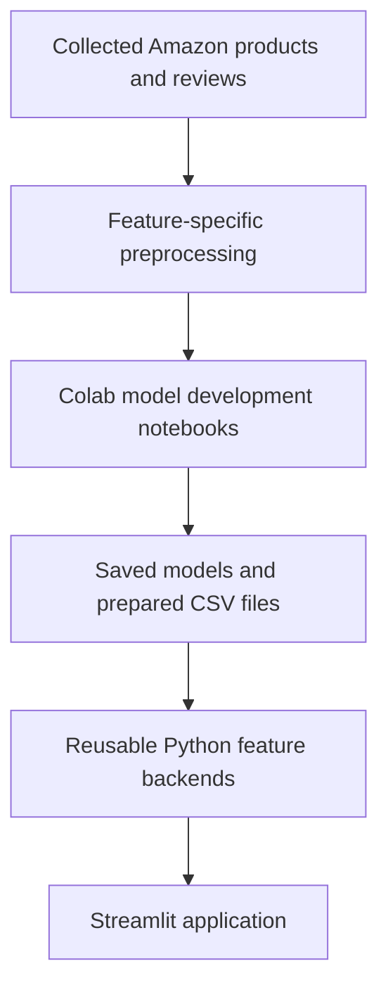

# Amazon Marketplace Product Intelligence Platform

A Streamlit application for exploring Amazon marketplace data through four analytical features:

1. Review Sentiment Analysis
2. Similar Product Recommendation
3. Thumbnail Grouping
4. Price Tier Classification

The project uses product and review data collected by the project’s own data collection pipeline. Model development is performed in Google Colab notebooks, while the saved artifacts and prepared CSV files are loaded by a local Streamlit application.

> This project is an analytical prototype. Model outputs are decision-support signals, not authoritative statements about a product, customer, or market.

## Table of contents

- [Project objective](#project-objective)
- [Key features](#key-features)
- [System architecture](#system-architecture)
- [Project structure](#project-structure)
- [Data and artifact flow](#data-and-artifact-flow)
- [Feature implementation](#feature-implementation)
  - [1. Review Sentiment Analysis](#1-review-sentiment-analysis)
  - [2. Similar Product Recommendation](#2-similar-product-recommendation)
  - [3. Thumbnail Grouping](#3-thumbnail-grouping)
  - [4. Price Tier Classification](#4-price-tier-classification)
- [Evaluation summary](#evaluation-summary)
- [Installation](#installation)
- [Run the application](#run-the-application)
- [Notebook workflow](#notebook-workflow)
- [Validation commands](#validation-commands)
- [Docker](#docker)
- [Troubleshooting](#troubleshooting)
- [Reproducibility and leakage controls](#reproducibility-and-leakage-controls)
- [Known limitations](#known-limitations)
- [Git and delivery guidance](#git-and-delivery-guidance)
- [Walkthrough guide](#walkthrough-guide)

## Project objective

The platform provides one place where non-technical users can:

- browse the collected product catalogue;
- inspect product and review-level information;
- understand customer sentiment;
- find related products;
- explore visually similar product thumbnails; and
- estimate whether a product belongs to a Budget, Mid-range, or Premium price tier without passing its price to the classifier.

The implementation follows the client requirements that each analytical feature has its own preprocessing, analysis, model comparison, tuning, final selection, saved artifacts, and application interface.

The collection process must use publicly accessible pages only. It must not bypass authentication, CAPTCHAs, rate restrictions, or other access controls.

## Key features

| Feature | Input | Output | Main approach | Streamlit functionality |
|---|---|---|---|---|
| Sentiment Analysis | Review text | Negative, neutral, or positive sentiment | RoBERTa-assisted pseudo-labeling followed by a TF-IDF Logistic Regression application model | Overview, product analysis, keyword summary, and custom review classification |
| Similar Product Recommendation | Product ASIN or product search | Ranked similar products with reasons | TF-IDF content similarity selected against MiniLM and tuned hybrid candidates | Product search, product details, ranked recommendations, similarity scores, and recommendation reasons |
| Thumbnail Grouping | Locally downloaded product thumbnails | Visual group and visually related products | DINOv2-Small embeddings, PCA, and K-means clustering | Visual overview, group exploration, and similar-thumbnail search |
| Price Tier Classification | Title, description, brand, keyword, marketplace, review count, and rating | Budget, Mid-range, or Premium with probabilities and explanation | TF-IDF, categorical and numeric features with tuned Logistic Regression | Tier overview, existing/custom product classification, and tier explorer |

## System architecture



The separation between notebooks and application code is intentional:

- notebooks perform preprocessing, EDA, model development, comparison, tuning, evaluation, and artifact export;
- `src/features/` contains reusable loading and inference logic;
- `pages/` contains presentation logic;
- `app.py` is the application landing page; and
- the Streamlit application does not import or execute notebooks.

## Project structure

```text
Amazon-Marketplace-Product-Intelligence-Platform-BJIT/
|
|-- app.py
|-- README.md
|-- requirements.txt
|-- requirements_colab.txt
|-- Dockerfile
|-- .gitignore
|
|-- pages/
|   |-- 1_Sentiment_Analysis.py
|   |-- 2_Similar_Products.py
|   |-- 3_Thumbnail_Grouping.py
|   `-- 4_Price_Tier_Classification.py
|
|-- src/
|   |-- __init__.py
|   `-- features/
|       |-- __init__.py
|       |-- sentiment/
|       |   |-- __init__.py
|       |   |-- constants.py
|       |   |-- data_loader.py
|       |   |-- inference.py
|       |   `-- views.py
|       |-- recommendation/
|       |   |-- __init__.py
|       |   |-- constants.py
|       |   |-- data_loader.py
|       |   `-- inference.py
|       |-- thumbnail_grouping/
|       |   |-- __init__.py
|       |   |-- constants.py
|       |   |-- data_loader.py
|       |   `-- inference.py
|       `-- price_tier/
|           |-- __init__.py
|           |-- constants.py
|           |-- data_loader.py
|           `-- inference.py
|
|-- data/
|   |-- raw/
|   |   `-- amazon_products.csv
|   |-- manual_labels/
|   `-- processed/
|       |-- keyword_sentiment_summary.csv
|       |-- price_tier_predictions.csv
|       |-- product_sentiment_summary.csv
|       |-- reviews_sentiment_app.csv
|       |-- thumbnail_cluster_interpretation.csv
|       |-- thumbnail_cluster_representatives.csv
|       `-- thumbnail_group_assignments.csv
|
|-- models/
|   |-- sentiment/
|   |-- recommendation/
|   |   |-- final_recommendation_metadata.json
|   |   |-- final_recommendation_product_index.csv
|   |   |-- final_tfidf_matrix.npz
|   |   `-- final_tfidf_vectorizer.joblib
|   |-- thumbnail_grouping/
|   `-- price_tier/
|       |-- price_tier_pipeline.joblib
|       |-- price_tier_model_decision.json
|       |-- price_tier_metadata.json
|       `-- price_tier_feature_summary.csv
|
|-- notebooks/
|   |-- sentiment/
|   |   |-- 01_sentiment_preprocessing_eda.ipynb
|   |   `-- 02_sentiment_model_development.ipynb
|   |-- recommendation/
|   |   |-- 01_recommendation_preprocessing_eda.ipynb
|   |   `-- 02_recommendation_model_development.ipynb
|   |-- thumbnail_grouping/
|   |   `-- 01_thumbnail_preprocessing_eda.ipynb
|   `-- price_tier/
|       |-- 01_price_tier_preprocessing_eda.ipynb
|       `-- 02_price_tier_model_development.ipynb
|
|-- reports/
|   |-- sentiment/
|   |-- recommendation/
|   |-- thumbnail_grouping/
|   `-- price_tier/
|
`-- tests/
```

The repeated names `constants.py`, `data_loader.py`, and `inference.py` are intentional. Each file belongs to a different feature package and therefore has a different fully qualified import path.

## Data and artifact flow

### Raw data

`data/raw/amazon_products.csv` contains one row per collected product. Product reviews are retained as structured review data associated with the product record.

The collection pipeline should also retain its request log, including timestamp, result status, and whether each request succeeded, was blocked, or returned no data.

### Processed application data

The Streamlit application primarily reads compact prepared CSV files from `data/processed/`. This keeps normal page loading fast and prevents expensive notebook computations from running in the application.

### Saved models

Model artifacts are stored by feature under `models/`. The application loads expensive artifacts lazily and caches them where appropriate. Precomputed catalogue results are used for browsing, while saved models are loaded when a user requests live inference.

### Reports

`reports/` contains evaluation tables, plots, tuning results, confusion matrices, and short evaluation notes. These reports document model-development decisions but should not be required for normal application startup.

## Feature implementation

### 1. Review Sentiment Analysis

### Purpose

Classify each review as `negative`, `neutral`, or `positive`, then aggregate the results by product and collection keyword.

### Label creation

The collected reviews did not contain sentiment labels. The notebook therefore used `cardiffnlp/twitter-roberta-base-sentiment-latest` as a teacher model to generate pseudo-labels and class probabilities.

Quality controls included:

- a confidence threshold for identifying uncertain pseudo-labels;
- a manual-review flag for low-confidence or truncated text;
- preservation of class probabilities and confidence margins;
- exclusion of human-evaluation reviews from model training;
- exclusion of normalized-text matches to reduce leakage; and
- a separate manually labelled benchmark of 300 reviews.

Star ratings were used only for analysis and disagreement checks. They were not treated as unquestionable sentiment ground truth.

### Student model development

The downstream application compared three classical text classifiers:

- Complement Naive Bayes;
- Logistic Regression; and
- Linear SVM.

Each model used TF-IDF text features with unigrams/bigrams. Macro-F1 was the principal selection metric because all three sentiment classes matter and the class distribution is not perfectly balanced.

The notebook selected Logistic Regression for the application. A classical TF-IDF pipeline provides fast, deterministic CPU inference and avoids loading the much larger teacher transformer whenever a user opens the application.

### Text handling

- Missing review text is normalized safely.
- Repeated whitespace and invalid control characters are cleaned.
- Meaningful Unicode characters are preserved where possible.
- Empty reviews are not silently treated as valid sentiment evidence.

### Saved application outputs

- `data/processed/reviews_sentiment_app.csv`
- `data/processed/product_sentiment_summary.csv`
- `data/processed/keyword_sentiment_summary.csv`
- sentiment pipeline and metadata under `models/sentiment/`

### UI functionality

The Sentiment page provides:

1. **Overview** — overall class distribution and summary metrics.
2. **Product Analysis** — product search, review-level results, and product sentiment summary.
3. **Keyword Summary** — sentiment comparison across collection keywords.
4. **Custom Classifier** — sentiment prediction for user-entered review text.

### Result interpretation

The 300-review manual audit of the RoBERTa-generated labels reported:

- accuracy: `0.6233`;
- balanced accuracy: `0.5999`;
- macro-F1: `0.5606`; and
- weighted-F1: `0.6860`.

The selected Logistic Regression application model recorded pseudo-validation macro-F1 of approximately `0.7261` in the model-development notebook. These two scores measure different things: the manual audit measures agreement with human labels, while pseudo-validation measures agreement with the teacher-generated development labels. The pseudo-validation score must not be presented as human-verified accuracy.

### 2. Similar Product Recommendation

### Purpose

Given a product, return a deterministic ranked list of related products with a short explanation for every recommendation.

### Preprocessing

- Product identifiers are normalized.
- Duplicate ASIN records are consolidated.
- Title, description, brand, and related product text are cleaned.
- Missing text fields receive safe fallback values.
- Stable ASIN ordering is used as a tie-breaker.
- The selected product is explicitly removed from its own recommendations.

### Approaches compared

1. **TF-IDF** — lexical similarity from cleaned product content.
2. **MiniLM** — semantic similarity using `sentence-transformers/all-MiniLM-L6-v2`.
3. **Hybrid** — weighted TF-IDF, MiniLM, brand, and keyword signals.

Hybrid weights were tuned using a tuning split. The final method was selected using a separate holdout set, preventing the holdout results from influencing the weight search.

### Final selection

TF-IDF was selected because it produced the best final selection score and slightly stronger ranking quality and coverage than the tuned hybrid on the holdout set. It was also deterministic and fast on the current catalogue.

### Recommendation reasons

Reasons are created from shared content signals, such as overlapping product details, brand information, or product-group terms. The explanation describes why a result is related; it is not a causal claim.

### Saved runtime artifacts

- `models/recommendation/final_tfidf_vectorizer.joblib`
- `models/recommendation/final_tfidf_matrix.npz`
- `models/recommendation/final_recommendation_product_index.csv`
- `models/recommendation/final_recommendation_metadata.json`

### UI functionality

- search for a product by ASIN or title;
- inspect the selected product;
- request a configurable number of recommendations;
- view similarity scores and reasons; and
- open an available product link.

### Final holdout results

The final holdout contained 295 evaluated queries.

| Method | nDCG@5 | Precision@5 | Hit rate@5 | Catalogue coverage | Average response time |
|---|---:|---:|---:|---:|---:|
| **TF-IDF** | **0.9942** | **0.9932** | **1.0000** | **0.7401** | 0.2888 ms |
| Tuned Hybrid | 0.9936 | 0.9925 | 0.9966 | 0.7350 | 0.2374 ms |
| MiniLM | 0.9872 | 0.9844 | 0.9966 | 0.6809 | 0.2211 ms |

These results use the project’s relevance definition and collected catalogue. They should not be interpreted as universal recommendation quality across Amazon.

### 3. Thumbnail Grouping

### Purpose

Group product thumbnails by visual appearance without using Amazon category labels during clustering. The resulting groups represent recurring visual patterns, not business categories.

### Local image workflow

Thumbnails are downloaded before notebook execution and stored locally or in the mounted Google Drive project folder. The notebook reads those local files rather than repeatedly downloading URLs during feature development.

### Image inspection and preprocessing

The single thumbnail notebook performs the complete workflow:

- inventory creation and ASIN-to-image mapping;
- exact duplicate detection using SHA-256;
- RGB conversion and model-specific resizing/normalization;
- low-resolution, near-blank, and extreme-aspect-ratio checks;
- duplicate-aware processing so identical images are embedded once; and
- restoration of assignments to every product after clustering.

Observed preprocessing summary:

- 981 product thumbnails;
- 979 unique processed images;
- 2 duplicate image copies;
- 0 processing failures;
- 0 low-resolution thumbnails;
- 0 near-blank thumbnails; and
- 68 extreme-aspect-ratio warnings.

Quality warnings do not automatically remove a product. They identify images that require cautious interpretation.

### Embeddings compared

| Method | Images | Original dimensions | PCA dimensions | Explained variance |
|---|---:|---:|---:|---:|
| ResNet50 | 979 | 2,048 | 331 | 0.9501 |
| **DINOv2-Small** | **979** | **384** | **171** | **0.9501** |

Each embedding was L2-normalized. PCA retained approximately 95% explained variance before clustering.

### Cluster selection

Only K-means was used for final clustering. Candidate values of `k` were compared with:

- the elbow curve, used as a structural reference; and
- cosine silhouette score, used for final selection.

The elbow appeared near `k=13`, but DINOv2-Small reached its highest evaluated silhouette score at `k=26` (`0.4229`). ResNet50 reached `0.3590` at `k=28`. DINOv2-Small with 26 clusters was therefore selected.

The 26 clusters were not created because there were a similar number of collection keywords. K-means used image embeddings only. The groups represent patterns such as composition, dominant colors, product shape, background, packaging, or photographic layout. Keyword/category information may be examined afterward only as supporting interpretation.

### Final clustering results

- 26 visual groups;
- 979 unique image assignments;
- 981 complete product assignments after restoring duplicate mappings;
- final cosine silhouette score: `0.4229`;
- 0 missing assignments; and
- 0 clusters containing fewer than five images.

### Saved application outputs

- `data/processed/thumbnail_group_assignments.csv`
- `data/processed/thumbnail_cluster_representatives.csv`
- `data/processed/thumbnail_cluster_interpretation.csv`
- fitted PCA/K-means and metadata artifacts under `models/thumbnail_grouping/`

### UI functionality

The Thumbnail Grouping page focuses on three user tasks:

1. **Visual overview** — group count, group sizes, quality metrics, and representative images.
2. **Similar thumbnails** — select a product and retrieve visually related products with similarity explanations.
3. **Group explorer** — inspect the members and interpretation of an individual visual group.

### Result interpretation

A silhouette score of `0.4229` indicates useful visual structure with some overlap between groups. This is reasonable for marketplace imagery because products can share backgrounds, layouts, colors, and shapes without belonging to exactly the same product type.

### 4. Price Tier Classification

### Purpose

Predict `Budget`, `Mid-range`, or `Premium` using product attributes while excluding product price from the model inputs.

### Label creation

Price is used only during preprocessing to create reference labels. Products are compared within an appropriate marketplace/domain and keyword context where sufficient data exists:

- bottom approximate third: `Budget`;
- middle approximate third: `Mid-range`; and
- top approximate third: `Premium`.

Fallback thresholds are used when a marketplace-keyword group is too small. Products with missing prices are excluded from supervised label creation and model evaluation, but they can still receive application predictions after the model is trained.

The tiers are relative to the collected marketplace context. A Premium notebook and a Premium laptop do not imply comparable absolute prices.

### Data cleaning

- Scraped negative review counts are converted with `abs()` because the sign is a collection-format issue.
- Missing review count and rating values remain missing until the pipeline applies training-set median imputation.
- Explicit missing indicators are included.
- Ratings are accepted only within 0 to 5.
- Missing brand, keyword, and marketplace values become `Unknown`.
- Missing title and description values become empty text with missing indicators.
- Meaningful Unicode is preserved and whitespace is normalized.
- Explicit currency amounts are removed from title/description text to reduce indirect price leakage.

### Model features

The model uses:

- TF-IDF features from combined title and description;
- one-hot encoded brand, keyword, and marketplace;
- log-transformed review count;
- average rating;
- title and description lengths; and
- missing-value indicators.

The model does not use price, tier thresholds, ASIN, product URL, or image URL.

### Candidate models and selection

The notebook compares:

- Dummy baseline;
- Logistic Regression; and
- LinearSVC.

Logistic Regression and LinearSVC are suitable for high-dimensional sparse text/categorical features. Random Forest was not selected as the main candidate because it is generally less efficient for this sparse representation and would require additional dense-memory handling.

Tuning considered `C` and class weighting. Validation Macro-F1 was the primary selection metric, with balanced accuracy, minimum class F1, ordinal error, severe error rate, and response time used as supporting metrics.

The selected model was tuned Logistic Regression with:

- `C = 2.0`; and
- `class_weight = "balanced"`.

### Data splits

- 913 products with valid reference tiers;
- 639 training products;
- 137 validation products; and
- 137 untouched final-test products.

After final selection, the deployment model was fitted on the 776 training plus validation products. The 137 final-test products remained excluded from deployment refitting.

### Final-test results

| Metric | Result |
|---|---:|
| Accuracy | 0.4964 |
| Balanced accuracy | 0.4946 |
| Macro precision | 0.4922 |
| Macro recall | 0.4946 |
| Macro-F1 | 0.4920 |
| Minimum class F1 | 0.4419 |
| Ordinal MAE | 0.6569 |
| Severe Budget-to-Premium error rate | 0.1533 |
| Evaluated products | 137 |

Per-class F1 scores were approximately `0.5743` for Budget, `0.4419` for Mid-range, and `0.4598` for Premium.

The result is better than a majority-only baseline but remains moderate. Price position cannot be fully inferred from limited product metadata, and relative tiers can overlap. Predictions should therefore be displayed with probabilities/confidence and treated as analytical estimates.

### Saved runtime artifacts

- `data/processed/price_tier_predictions.csv`
- `models/price_tier/price_tier_pipeline.joblib`
- `models/price_tier/price_tier_model_decision.json`
- `models/price_tier/price_tier_metadata.json`
- `models/price_tier/price_tier_feature_summary.csv`

### UI functionality

1. **Tier Overview** — product counts, catalogue share, confidence, and tier distribution.
2. **Product Classification** — inspect a saved catalogue prediction or classify custom product attributes.
3. **Tier Explorer** — search and filter products by tier and collection keyword.

The custom form deliberately contains no price input.

## Evaluation summary

| Feature | Final decision | Principal reported result | Interpretation |
|---|---|---|---|
| Sentiment | TF-IDF Logistic Regression application model | Teacher/manual audit Macro-F1 `0.5606`; student pseudo-validation Macro-F1 about `0.7261` | Human agreement and pseudo-label agreement are reported separately |
| Recommendation | TF-IDF | Holdout nDCG@5 `0.9942`, Precision@5 `0.9932`, coverage `0.7401` | Strong within the project’s relevance definition |
| Thumbnail Grouping | DINOv2-Small + PCA + K-means, `k=26` | Cosine silhouette `0.4229` | Useful visual structure with expected overlap |
| Price Tier | Tuned Logistic Regression | Final-test Macro-F1 `0.4920` | Moderate estimate; confidence and limitations must be shown |

All reported values are tied to the current collected dataset and evaluation design. They may change when the catalogue, marketplaces, keywords, or review distribution changes.

## Installation

### Prerequisites

- Python 3.11 recommended
- Git
- A local copy of the required model and processed-data artifacts
- Docker Desktop only if using the Docker workflow

### Windows PowerShell

```powershell
git clone <repository-url>
cd Amazon-Marketplace-Product-Intelligence-Platform-BJIT

py -3.11 -m venv .venv
.\.venv\Scripts\Activate.ps1

python -m pip install --upgrade pip
python -m pip install -r requirements.txt
```

### macOS/Linux

```bash
git clone <repository-url>
cd Amazon-Marketplace-Product-Intelligence-Platform-BJIT

python3.11 -m venv .venv
source .venv/bin/activate

python -m pip install --upgrade pip
python -m pip install -r requirements.txt
```

### Dependency compatibility

Scikit-learn/joblib models should be loaded using the same scikit-learn version used when they were trained. The project requirements should pin that exact version rather than using an unrestricted version range.

Check the active version:

```powershell
python -c "import sklearn; print(sklearn.__version__)"
```

If the Colab model was trained with scikit-learn `1.6.1`, for example:

```powershell
python -m pip install "scikit-learn==1.6.1"
```

The actual pinned value must match the version recorded by the training environment.

## Run the application

From the repository root:

```powershell
streamlit run app.py
```

Streamlit normally opens:

```text
http://localhost:8501
```

The landing page links to:

- `pages/1_Sentiment_Analysis.py`
- `pages/2_Similar_Products.py`
- `pages/3_Thumbnail_Grouping.py`
- `pages/4_Price_Tier_Classification.py`

The paths passed to `st.page_link()` must exactly match the filenames inside `pages/`.

Stop the application with `Ctrl+C`.

## Notebook workflow

### Google Drive layout

The notebooks expect a mounted Google Drive project similar to:

```text
/content/drive/MyDrive/Amazon-Marketplace-Product-Intelligence-Platform-BJIT/
```

If the Drive directory has another name, update `PROJECT_ROOT` consistently before running the notebooks.

### Execution order

1. Run the data collection pipeline and validate `data/raw/amazon_products.csv` and the request log.
2. Run Sentiment preprocessing, then Sentiment model development.
3. Run Recommendation preprocessing, then Recommendation model development.
4. Run the single Thumbnail Grouping notebook from top to bottom.
5. Run Price Tier preprocessing, then Price Tier model development.
6. Copy the final runtime artifacts from Drive into the matching local `data/processed/` and `models/` folders.
7. Run the backend validation commands before launching Streamlit.

Colab variables exist only in the active runtime. After a runtime restart, rerun the environment/path setup cell before running later cells. A `NameError` such as `MODEL_DIR is not defined` usually means the setup cell was skipped.

## Validation commands

Run these commands from the repository root with the virtual environment active.

### Sentiment

```powershell
python -c "from src.features.sentiment import load_sentiment_data; reviews, products, keywords = load_sentiment_data(); print('Reviews:', len(reviews)); print('Products:', len(products)); print('Keywords:', len(keywords))"
```

Then use the Streamlit Custom Classifier to test one clearly positive, one neutral, and one clearly negative review.

### Similar Product Recommendation

Replace the example ASIN with one from the recommendation product index:

```powershell
python -c "from src.features.recommendation import recommend_by_asin; print(recommend_by_asin('8883707168', 3)[['asin', 'title', 'similarity_score', 'recommendation_reason']].to_string(index=False))"
```

Run it twice and confirm that the ranked ASIN order is unchanged.

### Thumbnail Grouping

```powershell
python -c "from src.features.thumbnail_grouping import get_similar_thumbnails; print(get_similar_thumbnails('8883707168', 3)[['asin', 'title', 'cluster_name', 'similarity_score', 'recommendation_reason']].to_string(index=False))"
```

Confirm that results have valid visual group names, non-null similarity scores, and explanations.

### Price Tier data

```powershell
python -c "from src.features.price_tier import load_price_tier_data, get_price_tier_overview; data = load_price_tier_data(); print('Products:', len(data)); print(get_price_tier_overview().to_string(index=False))"
```

### Price Tier live inference

```powershell
python -c "from src.features.price_tier import predict_price_tier; print(predict_price_tier(title='Wireless Bluetooth Headphones', description='Noise cancelling over-ear headphones', brand='Sony', keyword='headphones', marketplace='Amazon US', review_count='-1250', average_rating='4.5 out of 5'))"
```

Validate that:

- the output tier is Budget, Mid-range, or Premium;
- the three probabilities total approximately 1;
- the negative review-count sign is ignored; and
- no price is supplied to the function.

### Full UI check

```powershell
streamlit run app.py
```

Open every page and verify:

- navigation links work;
- product selectors and search controls work;
- empty filters return a clear result rather than crashing;
- missing optional values display a fallback;
- model-backed custom inference works; and
- error messages identify missing files or version incompatibilities.

## Troubleshooting

### Streamlit page not found

Example:

```text
StreamlitPageNotFoundError: Could not find page
pages/4_Price_Tier_Classification.py
```

Confirm that the file exists directly under `pages/` and that `app.py` uses the identical name:

```powershell
Get-ChildItem .\pages -Filter *.py | Select-Object Name
```

### `MODEL_DIR` or another path variable is undefined in Colab

The runtime was restarted or a setup cell was skipped. Rerun the cell that mounts Drive and defines `PROJECT_ROOT`, `PROCESSED_DIR`, `REPORT_DIR`, and `MODEL_DIR`.

### `_RemainderColsList` unpickling error

Example:

```text
AttributeError: Can't get attribute '_RemainderColsList'
```

The training and local scikit-learn versions differ. Check the Colab version and install the exact same version locally. Do not patch scikit-learn private classes or manually edit the `.joblib` file.

### Prediction probability columns are missing

The generated CSV and backend may use different naming conventions, such as `probability_budget` versus `budget_probability`. Use the updated Price Tier data loader, which standardizes supported aliases, or regenerate Step 6 outputs with the canonical names:

- `budget_probability`
- `mid_range_probability`
- `premium_probability`

### Import from a feature package fails

Check that:

- the feature folder contains `__init__.py`;
- the required function is exported by that `__init__.py`;
- Streamlit was started from the repository root; and
- the page adds the repository root to `sys.path` before feature imports.

### Required artifact is missing

Read the full path printed by the exception. Confirm that the artifact was copied from Google Drive into the matching local `data/processed/` or `models/<feature>/` directory. Filenames in each feature’s `constants.py` are authoritative.

## Reproducibility and leakage controls

- Deterministic random states are used for model splitting, tuning, clustering, and supported estimators.
- Recommendation ties are resolved with stable ASIN ordering.
- The recommendation holdout is separated from hybrid-weight tuning.
- Sentiment human-evaluation reviews and matching normalized texts are excluded from training.
- Price Tier model selection uses validation data; the final-test split is evaluated once.
- Product price and price-derived thresholds are excluded from Price Tier model inputs.
- Explicit currency amounts are removed from Price Tier text.
- Amazon category/keyword labels are not used to fit Thumbnail K-means clusters.
- Exact duplicate thumbnails are embedded once and mapped back afterward.
- Environment versions should be pinned, especially scikit-learn, NumPy, SciPy, and joblib.

## Known limitations

### Data scope

The catalogue represents assigned keywords and products available during collection. Results do not represent the entire Amazon marketplace.

### Sentiment

Pseudo-labels inherit limitations from the teacher model. Product reviews can contain sarcasm, mixed sentiment, domain-specific language, emojis, or sentiment about shipping rather than the product.

### Recommendation

High ranking metrics reflect the current evaluation proxy and catalogue. User-click or purchase feedback is not available, so offline relevance is not equivalent to business impact.

### Thumbnail groups

Clusters describe visual similarity and may combine different product types that share photographic composition. They are not guaranteed semantic categories.

### Price tiers

The classifier predicts a price position from correlated metadata without seeing price. Final-test performance is moderate, and marketplace pricing can change over time. Tiers should be retrained when the catalogue or pricing distribution changes materially.

### External availability

Product URLs and images may later become unavailable or change after collection. A delivery review should sample-check 5–10% of URLs against the collected records.

## Git and delivery guidance

Before committing:

```powershell
git status
```

Check model sizes:

```powershell
Get-ChildItem models -Recurse -File |
    Select-Object FullName, @{Name="SizeMB"; Expression={[math]::Round($_.Length / 1MB, 2)}}
```

Commit required source code, processed runtime data, small metadata, and model artifacts needed to run the application. Use Git LFS or approved artifact storage when a required model exceeds the repository host’s normal file-size limit.

Do not commit:

- `.venv/`;
- `__pycache__/`;
- `.ipynb_checkpoints/`;
- temporary exports;
- local secrets; or
- unnecessary duplicate raw image folders.

Example final commit message:

```text
Complete marketplace intelligence features with validated Streamlit workflows
```

## Walkthrough guide

A suggested 15-minute client walkthrough:

1. **Project objective and architecture — 2 minutes**
   - Explain collection, Colab development, saved artifacts, reusable backends, and Streamlit.
2. **Sentiment Analysis — 3 minutes**
   - Show overview, product reviews, keyword comparison, and custom classification.
   - Explain pseudo-labeling and the separate human audit.
3. **Similar Products — 3 minutes**
   - Select a product, show ranked results and reasons, and repeat the query to demonstrate determinism.
4. **Thumbnail Grouping — 3 minutes**
   - Show group sizes and representatives, then find similar thumbnails.
   - Explain why 26 groups were selected and why they are visual patterns rather than keywords.
5. **Price Tier Classification — 3 minutes**
   - Inspect an existing prediction and classify a custom product.
   - Point out the absence of a price input and discuss moderate final-test performance.
6. **Reproducibility and questions — 1 minute**
   - Show project structure, requirements pinning, reports, and validation commands.

## Final acceptance checklist

- [ ] Raw collected products and reviews are present.
- [ ] Request/response collection log is present and current.
- [ ] Product URLs are sample-checked against live pages where accessible.
- [ ] Feature notebooks run in their documented order.
- [ ] Required processed CSVs and models are available locally.
- [ ] All four Streamlit pages open from `app.py`.
- [ ] Sentiment custom classification works.
- [ ] Recommendation results are deterministic.
- [ ] Thumbnail groups show representatives and group sizes.
- [ ] Price Tier custom inference does not accept price.
- [ ] Requirements use the model-compatible scikit-learn version.
- [ ] Docker image builds and starts successfully.
- [ ] Project Questions & Clarifications Log is updated.
- [ ] Final Redmine update and Git commit are prepared.
